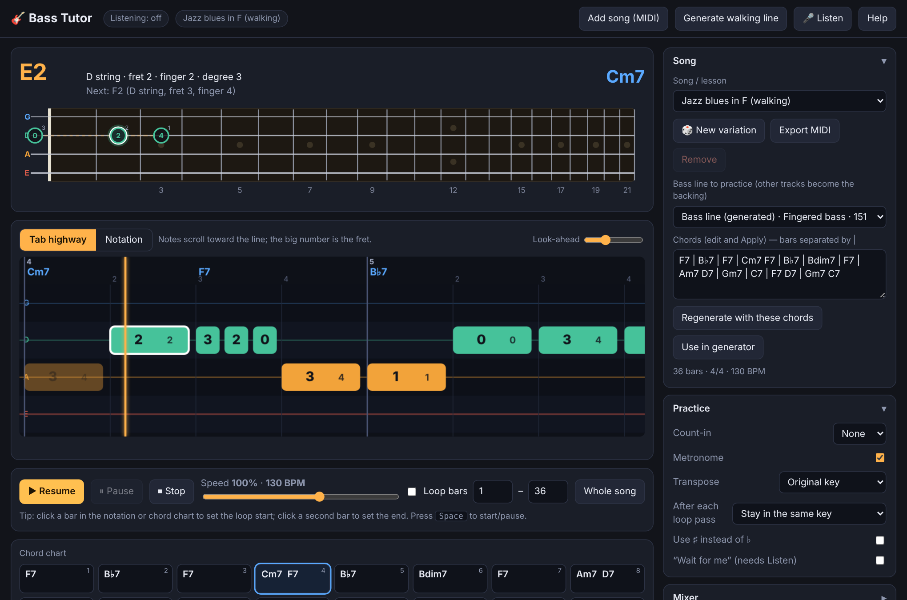

# Bass Tutor

A browser-based practice app for bass guitar, built around jazz walking bass lines. See exactly where your fingers go, loop the hard bars, practice in all 12 keys, and play along with MIDI backing tracks or a generated rhythm section.

Everything lives in one file, `index.html`. There is no build step and there are no dependencies.

## Features

**See the line**
- **Fretboard:** shows the current note and the next few, with the left-hand finger on each marker. Markers can show finger numbers, note names or chord degrees (R, 3, 5, ♭7). A whole-bar mode shows all of a bar's notes in order.
- **Tab highway:** notes scroll toward a hit line, with the fret number on each.
- **Notation:** bass clef, written an octave above sounding pitch, with tab numbers underneath.
- **Chord chart:** the current bar is highlighted. Click bars to set a loop.
- **Fingering optimizer:** picks the string, fret and finger for each note to minimize shifting. To change a note, pause and click it in the tab view to cycle through its other positions.

**Songs**
- **MIDI import:** load a `.mid` file (or drop one on the page). The bass track is detected automatically, and you can pick any other track instead. The remaining tracks and drums play as the backing.
- **Chords:** guessed from the other tracks, and editable in the Song panel.
- **Walking-bass generator:** type a chord chart such as `Dm7 | G7 | Cmaj7`, or pick a preset (jazz blues, ii–V–I, Autumn Leaves changes, rhythm changes, minor blues, bossa). You get a walking, two-feel or bossa line with piano and drums. "New variation" rolls a different line over the same chords, and you can export the result as MIDI.

**Practice tools**
- Loop any bar range, slow the tempo down to 25%, and use a count-in and metronome.
- Transpose, or have the loop move up a fourth (or another interval) each pass to cover all 12 keys. Fingering is recalculated for each key.
- Mixer: mute the bass to play it yourself, or solo it to study it.
- Tunings: standard, drop D, half-step down and 5-string. Fret count and left-handed flip are adjustable.

**Optional listening**
- Turn on **Listen** to detect the pitch of your bass through an audio interface or microphone.
- Notes are scored Perfect / Good / OK / Missed / Wrong, with timing in milliseconds.
- Includes latency calibration, "Wait for me" mode, a progress log and CSV export.

## Using it

Open `index.html` in Chrome or Edge. Press **Start** (or `Space`).

| Key | Action |
|---|---|
| `Space` | Start / pause |
| `Esc` | Stop |
| `V` | Switch tab / notation view |
| `L` | Toggle loop |
| `[` `]` | Slower / faster |
| `M` | Mute bass |

Click a bar in the notation or chord chart to set the loop start, then click a second bar to set the end.

### Listening setup
- An audio interface connected to your bass gives the best results. A microphone near the amp also works.
- Use headphones so the backing track doesn't feed back into the input.
- Run **Calibrate latency** once for your setup.
- Audio input needs a secure context, so it works on `https://` sites (such as Netlify) and `localhost`.

## Deploying

It is a static site, so any static host works.

**Netlify (from GitHub):** add the repo with **Add new site → Import an existing project**, leave the build command empty and set the publish directory to `.`. Every commit to `main` redeploys.

**Netlify (manual):** drag the folder onto **Add new site → Deploy manually**.

## Limitations

- Tempo and time-signature changes inside a MIDI file are not followed. The first ones are used.
- Chord detection is approximate and works best with full chord voicings in the backing tracks. Check the result and correct it in the Song panel.
- Songs, settings and progress are stored in the browser (`localStorage`), so they stay on that device and browser.
- Not installable or usable offline.

## Tech notes

- Plain HTML, CSS and JavaScript. Audio is a Web Audio synthesizer (bass, harmony, drums, click) with a look-ahead scheduler.
- MIDI parsing and writing are built in.
- Pitch detection uses the YIN algorithm on the input stream, with RMS onset detection.
- Fingering is a dynamic-programming search over string and fret positions.
